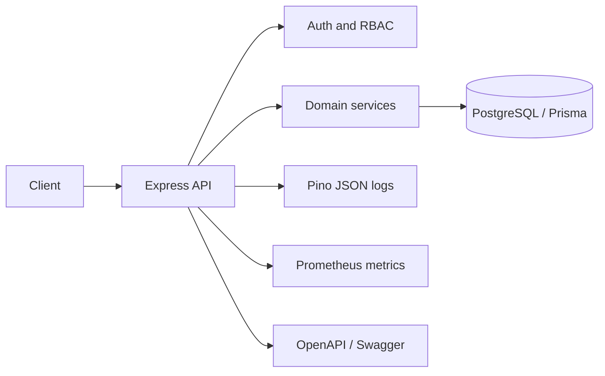
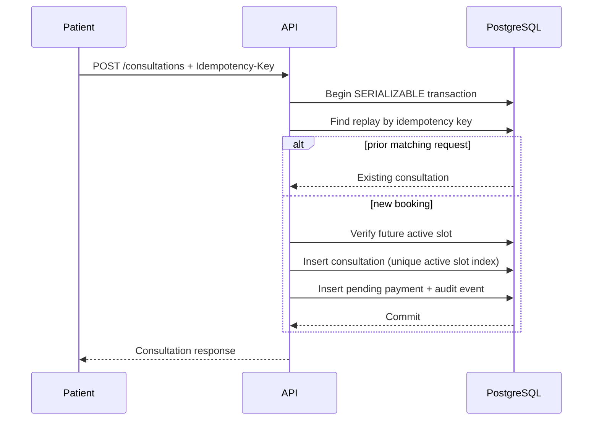

# Architecture

## Overview and data flow

The service is a modular monolith. Express routes validate and authenticate requests, then call domain services. Services own lifecycle rules and compose Prisma queries/transactions. PostgreSQL owns durable state, referential integrity, idempotency, and the final booking race guard. Keeping the first deployment as one API and one primary database keeps operations and interview explanation straightforward. No Redis or job broker is required for core synchronous flows.

Auth owns registration, password verification, access JWTs, refresh rotation and TOTP. Doctors own profile and search; availability owns time windows. Consultations own booking, status transitions, and prescriptions. Admin owns aggregate analytics and verification. Audit is append-only by application convention and indexed for lookup. The payment row is a local pending ledger stub, not a payment integration.

## Booking sequence and transaction

The unique idempotency-key constraint handles retries. Reuse of the key for a different patient or slot is rejected. A serializable transaction uses a conditional update of the slot (`isBooked = false` to `true`) as an atomic database claim; only one concurrent request can win. A conflict returns 409 and the client can refresh availability. Cancellation sets the slot back to unbooked while keeping the consultation row for history. Prisma transaction errors are not blindly retried; a client retry with its same key is safe.

## Consultation lifecycle

`BOOKED -> CONFIRMED -> IN_PROGRESS -> COMPLETED`; `BOOKED` and `CONFIRMED` can also transition to `CANCELLED`, and `CONFIRMED -> NO_SHOW`. Terminal states have no outgoing transitions. Patients can cancel their own booking; the assigned doctor or admin can perform clinician/admin transitions. Prescriptions are unique per consultation and can be created by its doctor during or after the visit. Payment is not coupled to an external system; when payment is added, use an outbox and explicit compensating/refund handling instead of holding a database transaction open across a network call.

## Scaling, cache and partitioning

The app is stateless apart from PostgreSQL and can scale horizontally behind a load balancer. Use a managed PostgreSQL primary with pooled connections (PgBouncer or provider pool), bounded per-instance pools, read replicas for analytics/search when replica lag is acceptable, and query/connection/lock monitoring. Existing indexes support doctor/specialty search, slot ranges, patient/doctor history, status analytics, and audit lookup. At 100k daily consultations (~1.2 average writes/sec) peak distribution and read amplification matter more than daily average; benchmark realistic bursts before sizing. Cache public doctor directory responses only after measuring, with short TTL and invalidation on profile/verification changes; never cache sensitive records in a shared cache without explicit authorization-aware keys.

Partition consultations and audit logs by creation month only when table size/query plans justify it. PostgreSQL partitioned uniqueness constraints include the partition key, so global idempotency requires a separate unpartitioned idempotency ledger or hash registry. Plan a backfill and retention strategy before partitioning. Do not claim the p95 or 99.95% goals are achieved without load and availability measurements.

## Failure handling and operations

Core database operations are atomic. No distributed saga is required until an external side effect exists; then persist an outbox event in the same transaction and run idempotent workers, recording compensations for failures. Use timeouts at ingress and database layers; do not retry validation, authorization, uniqueness, or business errors. If transient retries are introduced, cap them, jitter delays, and make worker handlers idempotent. Request IDs join logs to responses. Health checks distinguish liveness from database readiness. See `operations.md` for backups and recovery.
