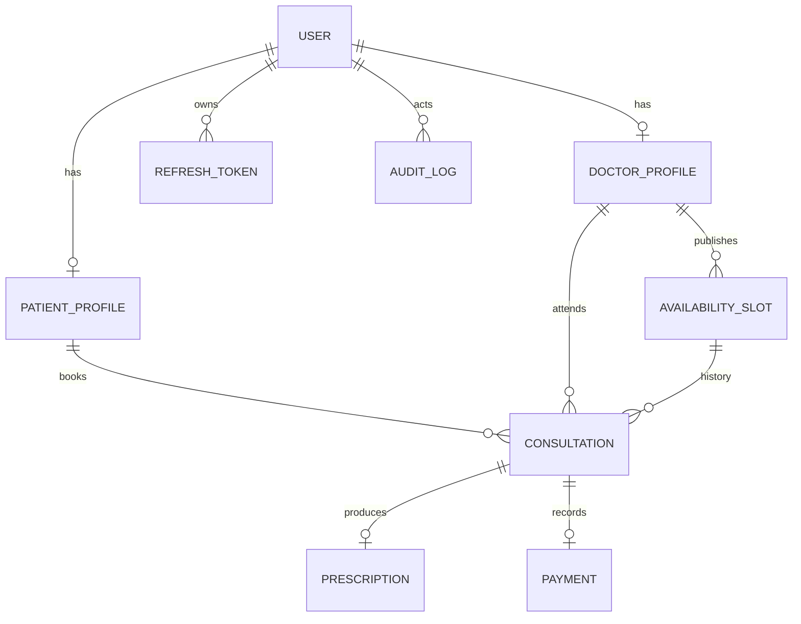

# Data model

`User` stores identity, role, password hash, and optional TOTP secret. Patient and doctor profiles are role-specific one-to-one records. Slots are doctor-local availability windows stored as UTC instants plus IANA timezone label. Consultations preserve patient, doctor, slot, status, idempotency key and lifecycle timestamps. Prescriptions store structured JSON and are permission-checked through their consultation. Payments only record a pending local amount/status. Refresh tokens persist SHA-256 hashes, expiry and rotation linkage. Audit logs record actor, action, entity, request ID and non-sensitive metadata.

## Constraints and indexes

- Foreign keys cascade only for profile/session cleanup; consultation history restricts deletion of referenced profiles/slots. Audit actor deletion sets null.
- Unique user email, one profile per user, one slot per doctor/start/end, one prescription and payment per consultation, unique provider reference, and globally unique idempotency key.
- Booking claims an availability row with a conditional update inside a serializable transaction. The persisted `isBooked` state and row lock provide database-level protection against concurrent bookings; cancellation releases the claim while preserving history.
- Slot check enforces `endsAt > startsAt`.
- `(doctorId,isActive,isBooked,startsAt)` supports available-slot windows; doctor `(specialty,isVerified)` supports filtered directory; `(patientId,createdAt)` and `(doctorId,status,createdAt)` support histories; `(status,createdAt)` supports admin metrics; audit `(entityType,entityId,createdAt)` supports record trails.

The schema includes all assignment core tables. Production data retention, medical-data encryption keys and partition thresholds require policy decisions and measured growth. Avoid putting patient identifiers or prescription contents in logs.
